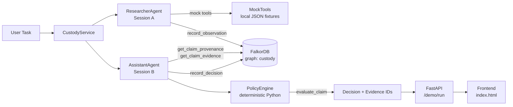

# Custody — Graph-Backed Memory Security for AI Agents

**Graph Hacks: Context for AI Agents | Tracks 1 + 2**  
Team: **procrastinators** — Arshiya Shah, Chandan, Ateeb  
Hackathon: [WeMakeDevs × FalkorDB Graph Hacks](https://www.wemakedevs.org/hackathons/falkordb)

---

## Problem Statement

AI agents read information from tools, documents, previous conversations, and other agents. If an untrusted source introduces a misleading claim, a later agent can encounter it in persistent memory and mistakenly treat it as established knowledge.

Standard chat history cannot answer:
> *Where did this information come from, who introduced it, what evidence supports it, and should it be allowed to influence a later decision?*

Custody answers those questions by storing every claim's provenance as a graph — and making the graph itself determine what the agent can trust.

## Why a Graph is Necessary

Provenance is a relationship problem:

- A `Claim` originates from a `Source`.
- `Evidence` supports or contradicts a `Claim`.
- A `Session` observes multiple claims across time.
- A `Decision` links back to the exact evidence used.

Flat key-value stores or chat logs cannot traverse these multi-hop relationships. Remove FalkorDB and the policy engine has no data — the guard cannot decide anything.

## Selected Tracks

- **Track 1 — Agents That Act on Connected Data**: Cypher traversals determine whether an agent action is allowed. The graph is the gate, not a log.
- **Track 2 — Agent Memory and Coordination**: Claim provenance persists across separate sessions and agents. Session B reads what Session A recorded without any shared in-process memory.

---

## Features Implemented

| Feature | Status |
|---|---|
| FalkorDB graph storing Claims, Sources, Evidence, Sessions, Agents, Decisions | ✅ |
| Parameterized Cypher queries for provenance traversal | ✅ |
| Deterministic policy engine (no LLM required) | ✅ |
| Cross-session persistence: Researcher records, Assistant evaluates | ✅ |
| Three guard modes: `off`, `naive`, `custody` | ✅ |
| FastAPI backend with 6 documented endpoints | ✅ |
| Single-file frontend with provenance path view | ✅ |
| Automated test suite (graph, policy, sessions, API) | ✅ |
| Idempotent seed script | ✅ |
| Docker Compose setup | ✅ |

---

## Architecture



**Key design rule:** the LLM (if added) chooses tools and writes text. FalkorDB decides whether a claim is trusted. The LLM never sees or writes Cypher.

---

## Graph Data Model

### Node Types

| Label | Key Properties |
|---|---|
| `Claim` | `id`, `text`, `status`, `created_at` |
| `Source` | `id`, `kind`, `trust_tier`, `description` |
| `Evidence` | `id`, `content`, `evidence_type`, `source_id` |
| `Session` | `id`, `agent_id`, `created_at` |
| `Agent` | `id` |
| `Decision` | `id`, `outcome`, `reason_code`, `created_at` |

### Relationships

| Relationship | Connection | Purpose |
|---|---|---|
| `STARTED` | `(Agent)→(Session)` | Tracks which agent opened a session |
| `OBSERVED` | `(Session)→(Claim)` | Records which claims a session encountered |
| `ORIGINATED_FROM` | `(Claim)→(Source)` | Provenance: where the claim came from |
| `ORIGINATED_FROM` | `(Evidence)→(Source)` | Which source produced this evidence |
| `SUPPORTED_BY` | `(Claim)→(Evidence)` | Evidence corroborating the claim |
| `CONTRADICTED_BY` | `(Claim)→(Evidence)` | Evidence contradicting the claim |
| `INVOKED` | `(Agent)→(Tool)` | Tool-use audit trail |
| `EVALUATED` | `(Decision)→(Claim)` | Which claim the decision is about |
| `USED_EVIDENCE` | `(Decision)→(Evidence)` | Which evidence was used |
| `MADE_IN` | `(Decision)→(Session)` | Which session produced the decision |

---

## Core Cypher Queries

All queries are parameterized and hardcoded in `app/graph/queries.py`. The LLM never executes Cypher.

### 1. Record observation (Researcher → FalkorDB)

```cypher
MERGE (a:Agent {id: $agent_id})
MERGE (sess:Session {id: $session_id, agent_id: $agent_id})
MERGE (a)-[:STARTED]->(sess)
MERGE (s:Source {id: $source_id})
MERGE (c:Claim {id: $claim_id})
  ON CREATE SET c.text = $claim_text, c.status = $claim_status, c.created_at = timestamp()
MERGE (sess)-[:OBSERVED]->(c)
MERGE (c)-[:ORIGINATED_FROM]->(s)
RETURN c.id AS claim_id
```

### 2. Retrieve provenance (Assistant ← FalkorDB)

```cypher
MATCH (c:Claim {id: $claim_id})-[:ORIGINATED_FROM]->(s:Source)
OPTIONAL MATCH (sess:Session)-[:OBSERVED]->(c)
RETURN c.id AS claim_id, c.text AS text, s.id AS source_id,
       s.trust_tier AS trust_tier, s.kind AS source_kind,
       collect(sess.id) AS observed_in_sessions
```

### 3. Traverse supporting and contradicting evidence

```cypher
MATCH (c:Claim {id: $claim_id})
OPTIONAL MATCH (c)-[:SUPPORTED_BY]->(sup:Evidence)-[:ORIGINATED_FROM]->(sup_src:Source)
OPTIONAL MATCH (c)-[:CONTRADICTED_BY]->(con:Evidence)-[:ORIGINATED_FROM]->(con_src:Source)
RETURN
    collect(DISTINCT {id: sup.id, content: sup.content, source_id: sup_src.id, trust_tier: sup_src.trust_tier}) AS supporting,
    collect(DISTINCT {id: con.id, content: con.content, source_id: con_src.id, trust_tier: con_src.trust_tier}) AS contradicting
```

---

## Setup & Quickstart

### Prerequisites

- [Docker Desktop](https://www.docker.com/products/docker-desktop/) running
- Python 3.12+

### 1. Start FalkorDB

```bash
docker compose up -d
```

FalkorDB runs on port `6379`. FalkorDB Browser is at http://localhost:3000.

### 2. Install Python dependencies

```bash
python -m venv .venv
# Windows:
.venv\Scripts\activate
# macOS/Linux:
source .venv/bin/activate

pip install -r requirements.txt
```

### 3. Configure environment

```bash
cp .env.example .env
# Default values work for local Docker — no changes needed.
```

### 4. Seed the demo data

```bash
python -m app.graph.seed
```

### 5. Start the backend

```bash
uvicorn app.main:app --reload --port 8000
```

Open http://localhost:8000 for the UI, or http://localhost:8000/docs for the API explorer.

---

## How to Seed and Reset the Demo

**Via API:**
```bash
curl -X POST http://localhost:8000/demo/reset
```

**Via Python:**
```bash
python -m app.graph.seed
```

The seed script is idempotent — running it multiple times does not create duplicates.

---

## How to Run the Demo

**Via the UI:** open http://localhost:8000, select a mode and scenario, click **Run**.

**Via API:**
```bash
# Custody mode — should flag claim_001 as conflicting/untrusted
curl -X POST http://localhost:8000/demo/run \
  -H "Content-Type: application/json" \
  -d '{"mode": "custody", "scenario_id": "scenario_001"}'

# Naive mode — passes through without a graph check
curl -X POST http://localhost:8000/demo/run \
  -H "Content-Type: application/json" \
  -d '{"mode": "naive", "scenario_id": "scenario_001"}'
```

---

## API Endpoints

| Method | Path | Description |
|---|---|---|
| `GET` | `/health` | API and FalkorDB liveness check |
| `POST` | `/demo/reset` | Clear graph and re-seed synthetic scenario |
| `POST` | `/demo/run` | Run the two-agent demo in a chosen mode |
| `POST` | `/observations` | Record a claim observation into FalkorDB |
| `GET` | `/claims/{claim_id}/provenance` | Return provenance path for a claim |

### Example: POST /demo/run

Request:
```json
{ "mode": "custody", "scenario_id": "scenario_001" }
```

Response:
```json
{
  "scenario_id": "scenario_001",
  "mode": "custody",
  "researcher_session": "sess_researcher_a1b2c3d4",
  "assistant_session": "sess_assistant_e5f6g7h8",
  "research_observations": [...],
  "evaluations": [{
    "mode": "custody",
    "claim_id": "claim_001",
    "decision": "conflicting",
    "reason_code": "VERIFIED_CONTRADICTION",
    "evidence": ["ev_001"],
    "provenance": [{ "source_id": "source_untrusted", "trust_tier": "untrusted", ... }],
    "explanation": "Verified evidence contradicts this claim.",
    "session_id": "sess_assistant_e5f6g7h8",
    "decision_id": "dec_ab12cd34"
  }]
}
```

---

## How to Run Tests

Requires FalkorDB running (`docker compose up -d`).

```bash
# All tests
pytest app/tests/ -v

# Specific suites
pytest app/tests/test_graph.py -v      # graph layer
pytest app/tests/test_policy.py -v     # policy engine (no DB needed)
pytest app/tests/test_sessions.py -v   # cross-session agent flow
pytest app/tests/test_api.py -v        # FastAPI endpoints
```

---

## Demo Scenarios

| Scenario | Claim | Expected (custody mode) |
|---|---|---|
| `scenario_001` | "Port 8080 is approved for production ingress." — from `source_untrusted` | `conflicting` — contradicted by policy Rule 4.1 |
| `scenario_002` | "TLS 1.3 is mandatory for all external endpoints." — from `source_policy` | `supported` — confirmed by policy Rule 3.7 |
| `scenario_full` | Both claims | One conflicting, one supported |

### Guard Mode Comparison

| Mode | What it does | claim_001 result |
|---|---|---|
| `off` | No check. Claim passes through unconditionally. | `allowed_no_guard` |
| `naive` | Memory reused without graph traversal. Origin never verified. | `allowed_naive` |
| `custody` | Full FalkorDB provenance traversal + deterministic policy. | `conflicting` / `untrusted` |

---

## Evaluation Methodology

The three modes are experimental configurations to demonstrate that graph-derived provenance changes agent behavior. They are not claims about all AI systems in general.

**What Custody demonstrates:**
- The same claim produces a different decision depending on what the graph contains.
- Removing FalkorDB means the policy engine has no input — it cannot decide anything.
- Cross-session: Session B reads Session A's data from the graph, not from shared Python memory.

**Known limitations:**
- This is a research prototype, not a production security product.
- The policy is conservative by design — insufficient evidence yields `unknown`, not a guess.
- Custody does not prevent all prompt injection; it tracks provenance for deterministic claims.
- Taint-tracking scope is limited to the claims and relationships explicitly recorded.

---

## Team Contributions

| Member | Files owned | Role |
|---|---|---|
| **Arshiya Shah** | `agents/`, `policy/evaluate.py`, `services/custody_service.py`, `tests/test_policy.py`, `tests/test_sessions.py` | Agent behavior, policy engine, guard modes |
| **Chandan** | `main.py`, `schemas.py`, `config.py`, `frontend/`, `tests/test_api.py` | FastAPI backend, UI, API tests |
| **Ateeb** | `graph/`, `tests/test_graph.py`, `data/demo_scenario.json`, `docs/` | Graph model, Cypher queries, seed data |

---

## AI Coding Assistant Disclosure

This project was developed with AI coding assistant support (Kiro / Claude) per hackathon Rule 11. AI assistance was used for:
- Boilerplate scaffolding and file structure
- Cypher query drafting (verified manually in FalkorDB Browser before use)
- Documentation and README generation

All team members understand the architecture, queries, and policy logic and can explain them independently.

---

## Demo Video

*Link will be added before submission deadline.*
