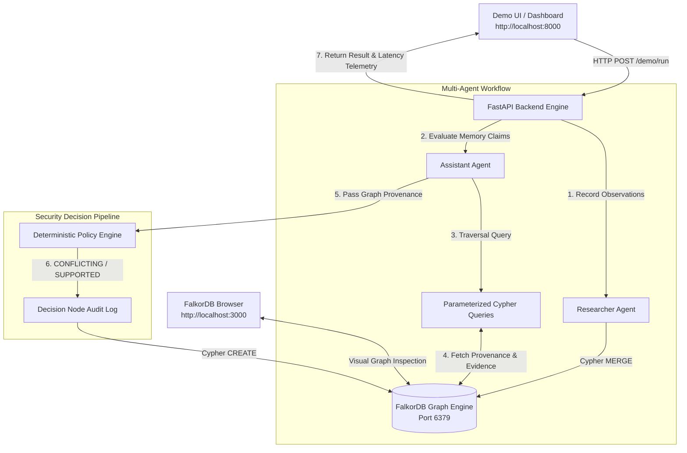

# Custody — Graph-Backed Memory Security for AI Agents

> **WeMakeDevs × FalkorDB Graph Hacks: Context for AI Agents**
> **Tracks:** Track 1 (Agents That Act on Connected Data) & Track 2 (Agent Memory and Coordination)
> **Team:** procrastinators — Arshiya Shah, Chandan, Ateeb

---

## 🎥 Demo Video

*(Replace with your public or unlisted YouTube / Loom URL before final submission)*
LIVE APP:https://graphhacks-custody.onrender.com/

---

## 📌 Problem Statement

Multi-agent AI workflows increasingly rely on shared long-term memory to coordinate across sessions. However, when an agent encounters an unverified or malicious assertion—such as an untrusted document claiming an insecure port is production-approved—that assertion can be saved into persistent memory.

When a second agent retrieves this memory in a later session, it lacks lineage context:

* **Where did this claim originate?**
* **Which agent or source introduced it?**
* **Is there official policy evidence that contradicts it?**

Traditional vector databases index information by semantic similarity, allowing unverified claims to be retrieved and trusted without traversing origin lineage. Without explicit provenance checking, AI agents suffer from **"memory laundering"**—treating unverified assertions as ground truth simply because they appear in chat history or memory stores.

---

## 💡 Solution Overview & Executive Summary

**Custody** is a graph-backed provenance and memory security layer for AI agents powered by **FalkorDB**.

Instead of trusting stored claims unconditionally, Custody models claims, sources, policy evidence, sessions, agents, and decisions as a connected graph topology in FalkorDB. When an agent attempts to reuse a memory or execute an action based on a claim, Custody executes multi-hop Cypher queries to traverse origin sources and policy rules. A deterministic engine then evaluates the graph relationships before granting or denying permission.

```
                  ┌─────────────────────────────────────────────────────────┐
                  │                 Custody Guard Modes                     │
                  └─────────────────────────────────────────────────────────┘
                                               │
         ┌─────────────────────────────────────┼─────────────────────────────────────┐
         ▼                                     ▼                                     ▼
     [ OFF ]                               [ NAIVE ]                             [ CUSTODY ]
   No Guard Check                      Recalls Memory                        Executes FalkorDB
  Passes Unchecked                   Without Provenance                      Cypher Traversal
(Status: ALLOWED_NO_GUARD)         (Status: ACCEPTED_NAIVE)                 (Status: CONFLICTING)

```

---

## 🔎 Why FalkorDB for Memory Security?

Memory security is fundamentally a **relationship traversal problem**:

1. A **`Claim`** originates from a **`Source`** (which has a designated trust tier).
2. A **`Session`** observes a **`Claim`**.
3. An **`Evidence`** rule supports or contradicts a **`Claim`**.
4. A **`Decision`** evaluates a **`Claim`** using specific **`Evidence`**.

Flat vector search retrieves text based on distance metrics; it cannot navigate multi-hop origin chains (`Session → Claim → Source → Evidence`).

**How FalkorDB Drives Decisions:**

FalkorDB is not a passive logging store or visualization gimmick—it sits directly in the execution path. Before any policy decision is made in `custody` mode, the backend queries FalkorDB to extract source trust tiers and contradicting/supporting policy edges. If FalkorDB returns a `:CONTRADICTED_BY` relationship linked to a verified policy rule, the policy engine immediately flags and quarantines the claim. Removing FalkorDB removes the policy input entirely.

---

## 🏗️ Architecture



---

## 📐 Graph Data Model

### Node Labels

| Label | Key Properties | Purpose |
| --- | --- | --- |
| **`Claim`** | `id`, `text`, `status`, `created_at` | Declarative statement under trust evaluation |
| **`Source`** | `id`, `kind`, `trust_tier`, `description` | Lineage origin (e.g., `source_untrusted` vs `source_policy`) |
| **`Evidence`** | `id`, `content`, `evidence_type`, `source_id` | Ground-truth policy rule or explicit contradiction |
| **`Session`** | `id`, `agent_id`, `created_at` | Execution container tracking agent observations over time |
| **`Agent`** | `id` | Participating AI agent entity (`agent_researcher`, `agent_assistant`) |
| **`Decision`** | `id`, `outcome`, `reason_code`, `created_at` | Recorded audit entry documenting evaluation outcomes |

### Relationship Types

| Relationship | Direction | Purpose |
| --- | --- | --- |
| **`:STARTED`** | `(Agent) → (Session)` | Identifies which agent initiated a session |
| **`:OBSERVED`** | `(Session) → (Claim)` | Registers claims encountered during a session |
| **`:ORIGINATED_FROM`** | `(Claim) → (Source)` | Links a claim to its original source document |
| **`:ORIGINATED_FROM`** | `(Evidence) → (Source)` | Links policy evidence to an authoritative source |
| **`:SUPPORTED_BY`** | `(Claim) → (Evidence)` | Connects corroborating evidence to a claim |
| **`:CONTRADICTED_BY`** | `(Claim) → (Evidence)` | Connects contradicting policy rules to a claim |
| **`:EVALUATED`** | `(Decision) → (Claim)` | Links an audit decision record to the evaluated claim |
| **`:USED_EVIDENCE`** | `(Decision) → (Evidence)` | Cites specific evidence used in a policy decision |
| **`:MADE_IN`** | `(Decision) → (Session)` | Binds a decision record to the active evaluation session |

---

## ⚡ Core Cypher Queries

All database interactions use parameterized Cypher queries defined in `app/graph/queries.py` to prevent injection vulnerabilities.

### 1. Ingesting Claims & Observations (Researcher Agent)

```cypher
MERGE (a:Agent {id: $agent_id})
MERGE (sess:Session {id: $session_id, agent_id: $agent_id})
MERGE (a)-[:STARTED]->(sess)
MERGE (s:Source {id: $source_id})
MERGE (c:Claim {id: $claim_id})
  ON CREATE SET c.text = $claim_text, c.status = $claim_status, c.created_at = timestamp()
MERGE (sess)-[:OBSERVED]->(c)
MERGE (c)-[:ORIGINATED_FROM]->(s)
RETURN c.id AS claim_id

```

### 2. Fetching Claim Provenance & Lineage (Assistant Agent)

```cypher
MATCH (c:Claim {id: $claim_id})-[:ORIGINATED_FROM]->(s:Source)
OPTIONAL MATCH (sess:Session)-[:OBSERVED]->(c)
RETURN 
    c.id AS claim_id, 
    c.text AS text, 
    s.id AS source_id,
    s.trust_tier AS trust_tier, 
    s.kind AS source_kind,
    collect(DISTINCT sess.id) AS observed_in_sessions

```

### 3. Traversing Supporting & Contradicting Policy Evidence

```cypher
MATCH (c:Claim {id: $claim_id})
OPTIONAL MATCH (c)-[:SUPPORTED_BY]->(sup:Evidence)-[:ORIGINATED_FROM]->(sup_src:Source)
OPTIONAL MATCH (c)-[:CONTRADICTED_BY]->(con:Evidence)-[:ORIGINATED_FROM]->(con_src:Source)
RETURN
    collect(DISTINCT {
        id: sup.id, 
        content: sup.content, 
        source_id: sup_src.id, 
        trust_tier: sup_src.trust_tier
    }) AS supporting,
    collect(DISTINCT {
        id: con.id, 
        content: con.content, 
        source_id: con_src.id, 
        trust_tier: con_src.trust_tier
    }) AS contradicting

```

---

## 🛡️ Guard Modes Comparison

Custody compares three operational configurations against identical claims:

| Guard Mode | Description | Decision Output (`scenario_001`) | Reason Code |
| --- | --- | --- | --- |
| **`off`** | Guard disabled. Claims pass without graph checks. | `ALLOWED_NO_GUARD` | `GUARD_DISABLED` |
| **`naive`** | Recalls prior memory without checking origin lineage. | `ACCEPTED_NAIVE` | `STORED_IN_MEMORY` |
| **`custody`** | Full FalkorDB graph traversal and deterministic policy logic. | `CONFLICTING` | `CONTRADICTED_BY_POLICY` |

---

## 🧪 Demo Scenarios

* **`scenario_001` (Untrusted Claim - Production Port 8080):**
* **Statement:** *"Port 8080 is approved for external production ingress."*
* **Source:** `source_untrusted` (Trust Tier: `untrusted`).
* **Evidence:** Contradicted by `ev_001` (*"Rule 4.1: Internal ports 8080/8443 prohibited for external production ingress"*).
* **Custody Outcome:** `CONFLICTING` (`CONTRADICTED_BY_POLICY`). Claim is flagged and quarantined.


* **`scenario_002` (Verified Policy - Mandatory TLS 1.3):**
* **Statement:** *"TLS 1.3 is mandatory for external endpoints."*
* **Source:** `source_policy` (Trust Tier: `verified`).
* **Evidence:** Supported by `ev_002` (*"Rule 3.7: TLS 1.3 mandatory for external endpoints"*).
* **Custody Outcome:** `SUPPORTED` (`VERIFIED_BY_GRAPH`). Claim is accepted into active workflow context.


* **`scenario_full` (Full Evaluation Suite):**
* Evaluates `scenario_001` and `scenario_002` sequentially in a single run, demonstrating contrasting trust evaluations.


---

## 🖼️ User Interface & Cypher Observatory

The dashboard includes a real-time **Cypher Observatory** panel that renders the exact parameterized query executed against FalkorDB, along with measured execution duration (`latency_ms`) captured via `time.perf_counter()`.

```
┌─────────────────────────────────────────────────────────────────────────┐
│ ⚡ FalkorDB Executed Cypher                          [ 21.84 ms ]       │
├─────────────────────────────────────────────────────────────────────────┤
│ MATCH (c:Claim {id: $claim_id})                                         │
│ OPTIONAL MATCH (c)-[:SUPPORTED_BY]->(sup:Evidence)                      │
│ OPTIONAL MATCH (c)-[:CONTRADICTED_BY]->(con:Evidence)                   │
│ RETURN c, sup, con                                                      │
└─────────────────────────────────────────────────────────────────────────┘

```

*Screenshots located in `docs/screenshots/`:*

* `docs/screenshots/custody.jpeg` — Custody Active Defense flagging `scenario_001`.
* `docs/screenshots/native.png` — Naive mode accepting memory without checks.
* `docs/screenshots/test-passing.png` — Automated `pytest` execution showing all tests passing.

---

## 🚀 Quickstart & Setup Guide

### Prerequisites

* **Git**
* **Docker Desktop** (Running)
* **Python 3.12+**

---

### Step 1: Clone Repository & Create Virtual Environment

**Windows PowerShell:**

```powershell
git clone https://github.com/ARSHIYASHAH1511/GRAPHHACKS-CUSTODY.git
cd GRAPHHACKS-CUSTODY

python -m venv .venv
Set-ExecutionPolicy -ExecutionPolicy RemoteSigned -Scope Process -Force
.\.venv\Scripts\Activate.ps1
python -m pip install --upgrade pip
pip install -r requirements.txt

```

**macOS / Linux:**

```bash
git clone https://github.com/ARSHIYASHAH1511/GRAPHHACKS-CUSTODY.git
cd GRAPHHACKS-CUSTODY

python3 -m venv .venv
source .venv/bin/activate
python3 -m pip install --upgrade pip
pip install -r requirements.txt

```

---

### Step 2: Launch FalkorDB Infrastructure

Start the FalkorDB graph container using Docker Compose:

```bash
docker compose up -d

```

* **FalkorDB Database Server:** `localhost:6379`
* **FalkorDB Web Browser:** `http://localhost:3000`

---

### Step 3: Seed Synthetic Scenario Graph Data

Initialize schema indexes and seed synthetic evaluation scenarios:

**Windows PowerShell:**

```powershell
$env:PYTHONPATH="."
python -m app.graph.seed

```

**macOS / Linux:**

```bash
PYTHONPATH=. python3 -m app.graph.seed

```

---

### Step 4: Launch FastAPI Application

```bash
uvicorn app.main:app --reload --port 8000

```

Access services at:

* **Interactive Web UI:** `http://localhost:8000`
* **Swagger OpenAPI Docs:** `http://localhost:8000/docs`
* **FalkorDB Web Visualizer:** `http://localhost:3000`

---

## 🔌 API Reference

### Core Endpoints

| Method | Endpoint | Description | Sample Payload |
| --- | --- | --- | --- |
| `GET` | `/health` | Liveness check & FalkorDB ping | N/A |
| `POST` | `/demo/reset` | Resets and re-seeds synthetic scenario graph | N/A |
| `POST` | `/demo/run` | Executes multi-agent evaluation workflow | `{"mode": "custody", "scenario_id": "scenario_001"}` |
| `POST` | `/evaluate` | Direct single-claim evaluation with telemetry | `{"claim_id": "claim_001", "mode": "custody"}` |
| `POST` | `/observations` | Ingests new claim observation into FalkorDB | `{"agent_id": "a1", "session_id": "s1", "claim": {...}, "source_id": "src1"}` |
| `GET` | `/claims/{claim_id}/provenance` | Fetches raw graph provenance path for a claim | N/A |

#### Example CURL Command

```bash
curl -X POST http://localhost:8000/evaluate \
  -H "Content-Type: application/json" \
  -d '{"claim_id": "claim_001", "mode": "custody"}'

```

---

## 🧪 Automated Testing Suite

To run automated unit and integration tests against the live FalkorDB container:

```bash
# Execute complete test suite
pytest app/tests/ -v

# Run targeted test modules
pytest app/tests/test_graph.py -v     # FalkorDB Schema & Query Verification
pytest app/tests/test_policy.py -v    # Policy Engine Logic Verification
pytest app/tests/test_sessions.py -v  # Cross-Session Agent Handoff Tests
pytest app/tests/test_api.py -v       # FastAPI Endpoint Integration Tests

```

---

## 🔒 Limitations & Security Scope

Custody is an experimental hackathon research prototype designed to demonstrate graph-backed provenance security:

* **Scope:** Evaluates structured claims, origin sources, and policy contradictions stored in FalkorDB.
* **LLM Boundary:** Prevents unauthorized memory promotion and context laundering across sessions; does not claim to prevent real-time prompt injection at the LLM token layer.
* **Data Scope:** Policy evaluation relies strictly on claims, sources, and evidence explicitly recorded in the graph topology.

---

## 👥 Team & Contributions

* **Arshiya Shah (Engineering Lead):** Agent interaction workflows (`app/agents/`), deterministic policy logic (`app/policy/`), guard mode evaluations, and unit test suites (`app/tests/test_policy.py`, `app/tests/test_sessions.py`).
* **Chandan (Full-Stack Lead):** FastAPI application architecture (`app/main.py`), REST schema definitions, UI dashboard design, and Cypher Observatory panel (`app/templates/index.html`, `frontend/`).
* **Ateeb (Database & Data Architect):** FalkorDB graph schema design (`app/graph/schema.py`), parameterized Cypher query engine (`app/graph/queries.py`), idempotent data ingestion (`app/graph/seed.py`), Docker environment setup, and test validation (`app/tests/test_graph.py`).

---

## 🤖 AI Assistance Disclosure

Per **Hackathon Rule 11**, AI coding assistants (Gemini / Claude) were used for boilerplate generation, unit test scaffolding, and Markdown formatting. All core Cypher queries, FalkorDB graph schemas, policy rules, and FastAPI route handlers were manually authored, reviewed, and validated against live FalkorDB Docker instances.

---

## 🙏 Acknowledgments

Built for **Graph Hacks: Context for AI Agents**, organized by **WeMakeDevs** and **FalkorDB**.
